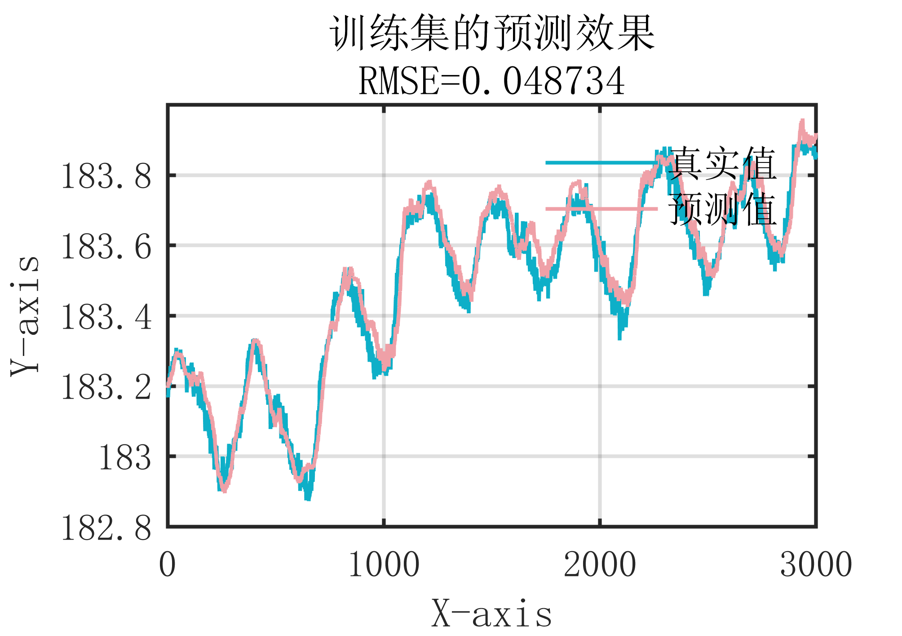
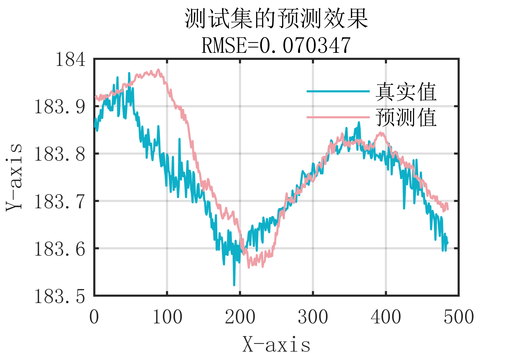

# MATLAB | Time Series Prediction | CNN Convolutional Neural Network | Attached data and code for plotting | Directly Hands On

1. Basic Definition
CNN (Convolutional Neural Network) is a type of feedforward neural network primarily used for processing data with grid-like structures, such as images and audio. The main characteristic of CNN is the alternating use of convolutional layers and pooling layers to extract data features, followed by fully connected layers for classification and recognition of these features. The main components of CNN include convolutional layers, pooling layers, and fully connected layers. Convolutional layers are mainly used for feature extraction from the data, where a small convolutional kernel slides over the data to extract local features. Pooling layers are used to reduce the dimensionality of the data and decrease the number of features, thereby simplifying the complexity of the model. Fully connected layers are used to map extracted features to specific classification or recognition results. CNN has achieved excellent results in fields such as image recognition, speech recognition, and natural language processing compared to traditional machine learning algorithms. Compared to traditional machine learning algorithms, CNN does not require manual feature extraction but learns features from the data, thus better solving complex pattern recognition problems. Additionally, the parameter sharing and weight sharing mechanisms of CNN make the model training faster and have strong robustness to data transformations and noise. In summary, CNN is an important deep learning algorithm that has wide applications in image, speech, and natural language fields, and is one of the most advanced image recognition algorithms currently available.
2. Definition and Outline Effects
Video tutorial operation:
\n        \n          \n          \n          \n          \n            To view this video please enable JavaScript, and consider upgrading to a\n            web browser that\n            supports HTML5 video\n  

## Images

<!-- PAYMENT_BLOCK -->

## Get this dataset

- Payment link (Stripe): [Buy now](https://buy.stripe.com/3cs8yP7sY87d0vu9AB)
- Payment QR code: 

<!-- /PAYMENT_BLOCK -->
